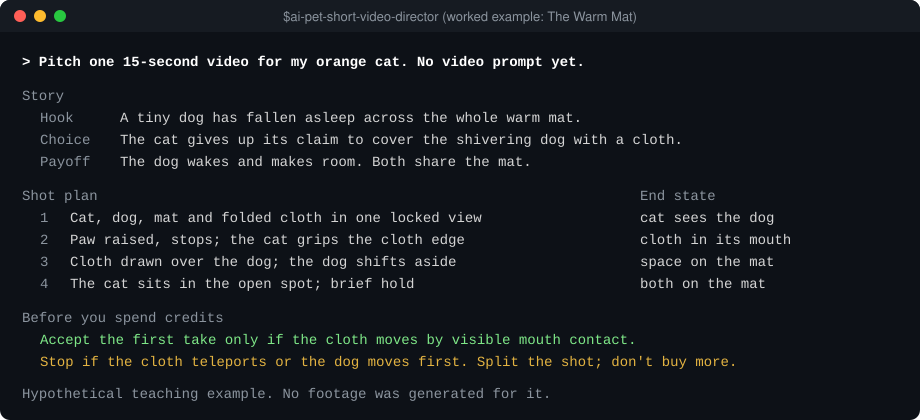

# AI Pet Short Video Director

**A director and producer agent skill for cute-pet AI short videos.** It takes a recurring pet IP from a visible story idea through animal blocking, generation planning, real-footage review, editing, and learning from results. It's for creators running a series about a cat, dog, or other companion animal, not for unrelated shorts about people or general film projects.

**AI 萌宠短视频导演／制片 Skill。** 从能看懂的故事、动物表演和镜头设计出发，控制付费生成的风险，再用真实素材决定剪辑、返工或止损。适用于猫、狗及其他伴侣动物的系列短视频；不面向无关的人物短片或通用电影项目。



## Why it exists / 为什么做

An AI video prompt can be grammatically correct and still produce an unreadable film. This skill asks the director to settle four questions before spending credits:

1. What visibly changes, and why does the lead character cause it?
2. Where do the pet, camera, props, and other animals or people start and end?
3. What is the smallest generation unit the chosen tool can execute clearly?
4. What observable result would make the first take usable or trigger a stop?

It is an original skill by [Balance Zhao](https://x.com/balance0014). The public package contains no private character bible, account data, project ledger, or current production state. Its examples are hypothetical teaching material, not claimed production results.

## Install / 安装

```bash
npx skills add Balance0014/ai-pet-short-video-director
```

In Claude Code, it also installs as a plugin:

```text
/plugin marketplace add Balance0014/ai-pet-short-video-director
/plugin install ai-pet-short-video-director@ai-pet-short-video-director
```

Or copy the [`plugin/skills/ai-pet-short-video-director`](plugin/skills/ai-pet-short-video-director) folder into your AI agent's skills directory and reload the agent. The entry point is [`SKILL.md`](plugin/skills/ai-pet-short-video-director/SKILL.md). All references use relative paths; no database, paid account, or local project layout is required.

Example prompt / 使用示例：

> Use `$ai-pet-short-video-director` to pitch one 15-second AI video for my recurring orange cat. Give visible beats, the cat's decisive choice, an earned ending, and the main generation risk. Do not write a video prompt yet.

Then, after approving the story:

> Turn the approved story into a shot plan and one generation prompt for my chosen tool. I have a character identity image and a scene image. State what each reference controls and how I will judge the first take.

The skill also supports direct requests to diagnose a script, plan a shot, rewrite a prompt, or review actual footage. It works in the user's language.

## Structure / 结构

The Claude plugin is the [`plugin/`](plugin) folder. It holds only Markdown, JSON, and an icon, and runs no code. The skill's files are in `plugin/skills/ai-pet-short-video-director/`, shortened to `…/` below.

| File | Purpose |
|---|---|
| [`.claude-plugin/marketplace.json`](.claude-plugin/marketplace.json) | Lets Claude Code install the plugin from this repository |
| [`plugin/.claude-plugin/plugin.json`](plugin/.claude-plugin/plugin.json) | Plugin manifest: name, version, license, icon |
| [`plugin/README.md`](plugin/README.md) | Plugin README for the directory listing, including its data statement |
| [`…/SKILL.md`](plugin/skills/ai-pet-short-video-director/SKILL.md) | Entry point, routing, shared directing rules and boundaries |
| [`…/references/story.md`](plugin/skills/ai-pet-short-video-director/references/story.md) | Premise, visible causality, duration and story greenlight |
| [`…/references/direction.md`](plugin/skills/ai-pet-short-video-director/references/direction.md) | Blocking, coverage, keyframes, continuity and sound |
| [`…/references/generation.md`](plugin/skills/ai-pet-short-video-director/references/generation.md) | Tool controls, references, prompt forms and paid-step checks |
| [`…/references/review.md`](plugin/skills/ai-pet-short-video-director/references/review.md) | Real footage, edit, release review and measured learning |
| [`…/references/receipt.md`](plugin/skills/ai-pet-short-video-director/references/receipt.md) | Optional paid-generation evidence receipt |
| [`…/examples/cat-shares-warm-mat.md`](plugin/skills/ai-pet-short-video-director/examples/cat-shares-warm-mat.md) | Hypothetical end-to-end decision example |
| [`evals/cases.json`](evals/cases.json) | Behavior cases for a fresh-session manual evaluation |
| [`scripts/check_package.py`](scripts/check_package.py) | Local package integrity check |
| [`scripts/validate_receipt.py`](scripts/validate_receipt.py) | Validate one paid-prompt receipt and its evidence hashes |

## What “validated” means / 验证边界

Run `python3 scripts/check_package.py` from the repository root. It checks the package structure, the plugin manifests, linked local files, portability hazards, and that the plugin folder holds no executable code. It does **not** measure story quality or prove a video model will follow a prompt.

GitHub Actions runs this package check and the receipt validator's self-test on every push and pull request. A green check confirms package integrity, not directing quality.

For a substantial paid prompt, `python3 scripts/validate_receipt.py --self-test` checks the validator itself; `python3 scripts/validate_receipt.py path/to/receipt.json` checks one real project receipt. A passing receipt confirms fields, files, and hashes, not creative quality or generation success.

The cases in [`evals/cases.json`](evals/cases.json) are prompts and observable expectations. Run each in a fresh agent session with the skill installed, keep the full response, and grade the listed expectations. No model pass rate is claimed here. Real audience claims require real published videos with comparable observation times.

## Scope and safety / 使用边界

- The user chooses the pet, tool, cost, and publication decision.
- The skill does not execute a paid generation or publish a video from a request for a plan.
- It does not present synthetic rescue or injury footage as a real event.
- It can learn from filmmakers' methods without reproducing their protected shots, dialogue, characters, or plots.

## License

Copyright (c) 2026 Balance0014. Released under the [MIT License](LICENSE).

---

**More from [Balance Zhao](https://github.com/Balance0014):** [Post-quantum blockchain map](https://github.com/Balance0014/post-quantum-blockchains) (open for submissions) · [claim-check](https://github.com/Balance0014/claude-code-claim-check) · [when-to-clear](https://github.com/Balance0014/claude-code-when-to-clear) · [one-person-ai-company](https://github.com/Balance0014/one-person-ai-company) · [telegram-rug-checker](https://github.com/Balance0014/telegram-rug-checker)
